# 点亮数码管

## 1.0 数据手册查看
数码管作为新接触的元件，在正式开始点亮之前我们需要去看它的手册[《TOP-CC-5461AH 数据手册》](TOP-CC-5461AH.pdf)

### 1.1 如何去查看一份数据手册
接触所有不熟悉的东西的时候，大家的第一件事一定是查看数据手册，所以在这里教大家怎么去查看数据手册

打开数据手册前，首先一定要清楚这次查找数据手册是为了解决什么样的问题

然后带着问题在目录进行定位：比如说开发板主要需要查找接口定义、电机需要查看它的相关参数与控制方式

找到对应章节后，先看图表、参数和注意事项，留意适用条件以及是否有使用限制。再把手册中的信息与手里的实物、原理图和代码配置逐项对照；如果有不对的地方，先回到手册核实，不要凭印象接线或设置参数。

### 1.2 数码管数据手册的查看
打开数码管的数据手册，找到第三页对引脚的介绍

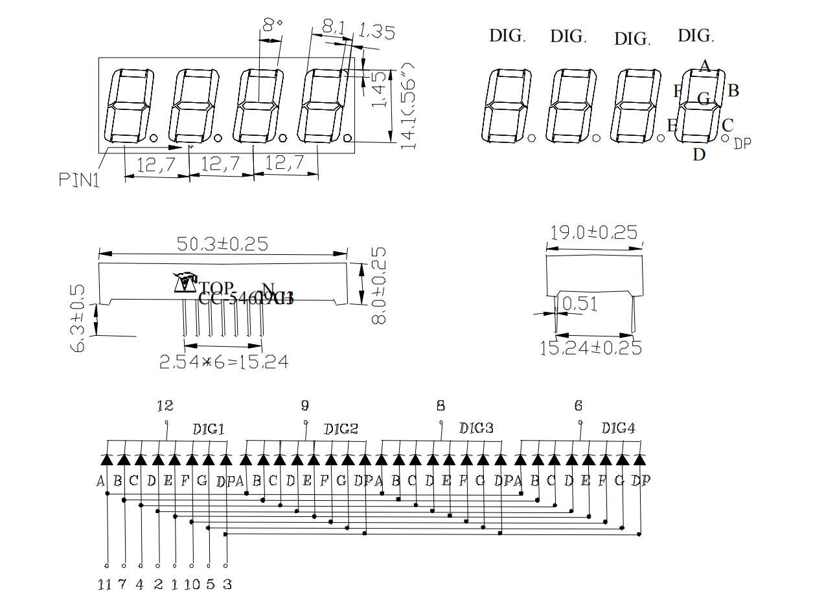

首先，先看到上面这里，框出来的这里在每一个这里标注了对应的字母

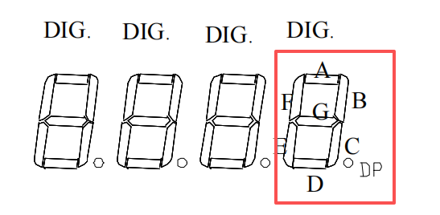

将这里的字母与下面的引脚标注进行对应，比如说这里的A和下面的就是对应的

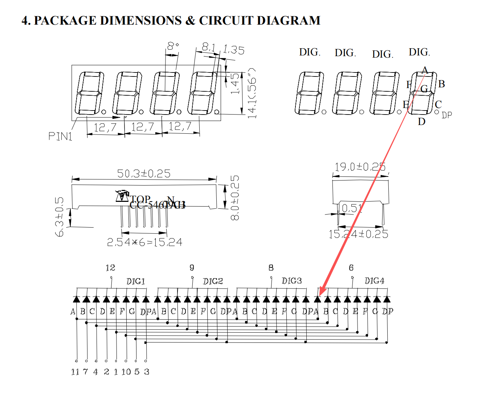

然后，看到下面这一块，上面这四个是阳极，下面的这一些是阴极，所以这是一个阳极数码管

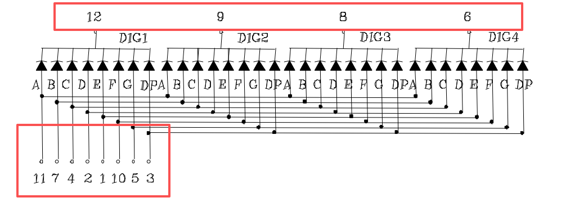

以DIG1为例，如果要点亮最上面标注为A的这里，在下面找到DIG1A对应的引脚，阳极为12，阴极为11，那么将11置为高，12置为低，这样就能点亮了

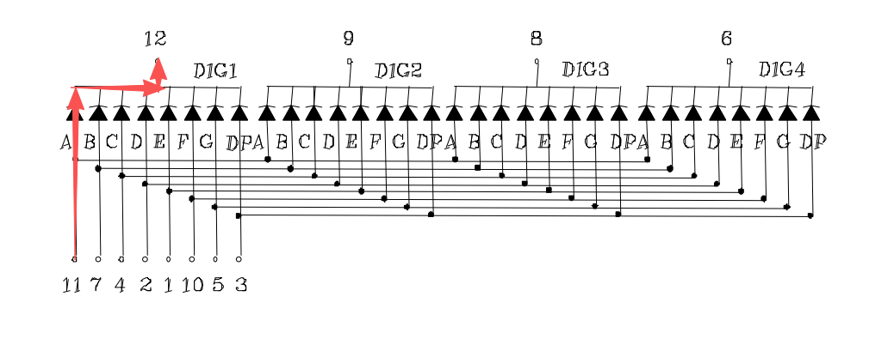

## 2.0 进行芯片配置

### 2.1 GPIO配置
将PA2到PA15配置为GPIO_Output

左键对应的引脚，选择GPIO_Output，此时这个引脚会变绿，旁边会出现一个GPIO_Output的标志

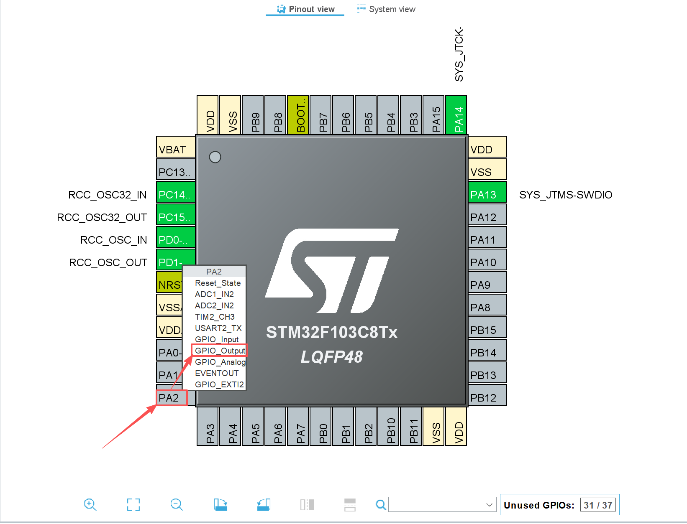

然后再右键一下，选择Enter User Label，然后对其进行命名，比如说这里给PA2命名为D1_12

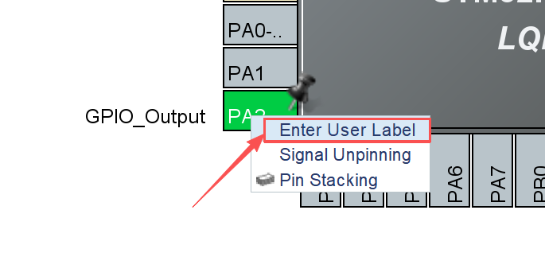

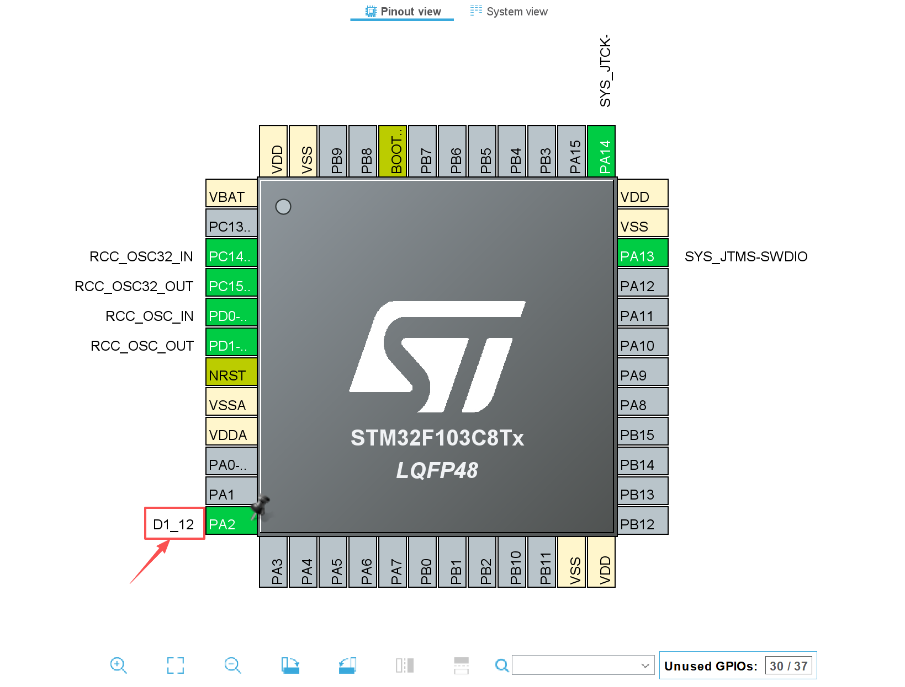

所有引脚的配置都是一样的流程，配置完的整体效果可以参考下图

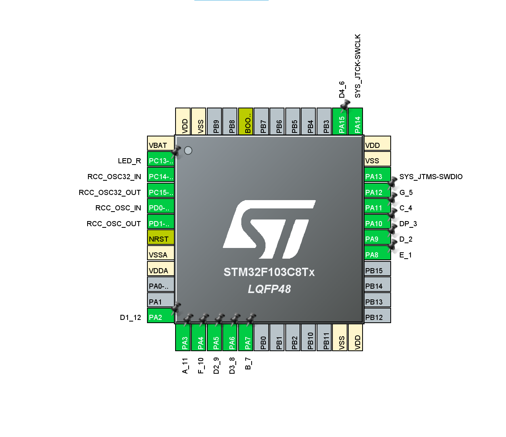

命名的时候不一定需要和图片保持一致，可以按照自己喜欢的方式来；在接下来的讲解中会按照这个配置来讲解

### 2.2 Timers配置
打开下面的Timers这一项，找到RTC，点开之后将Activate Clock Source和Activate Calendar都勾选上

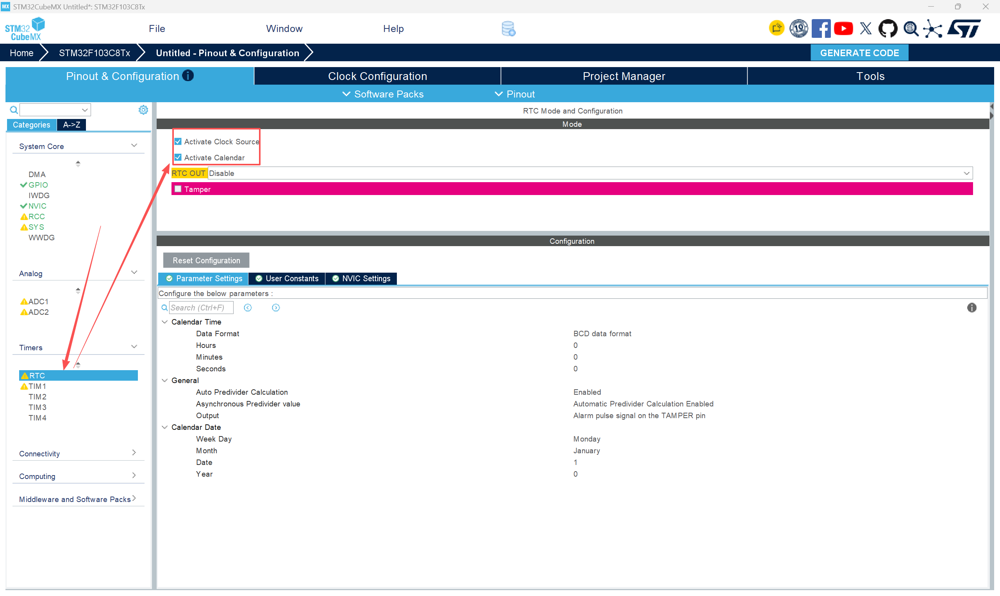

### 2.3 其余配置
剩余的NVIC、RCC、SYS配置和之前的配置方式是一样的，如果忘记了请回顾[使用STM32新建文件](./Lecture1小作业.md)的操作

剩下的就是GENERATE CODE，然后就可以进行下一步操作了

## 3.0 接线
下图为点亮数码管的参考实物接线图
（如果是按照前面进行一样的配置，一定要按照下图的顺序接线，否则很有可能会出现点亮效果和代码不符合的情况）

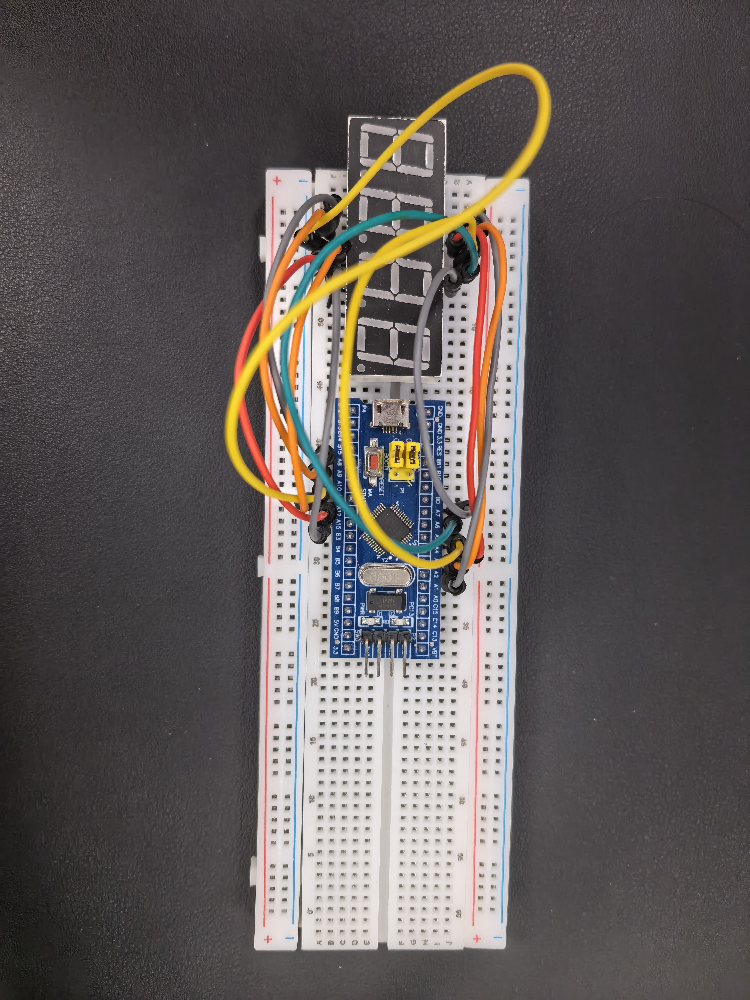

一定要注意，数码管的针脚并不是整个数码管下面都有，接线的时候一定要注意针脚的对应

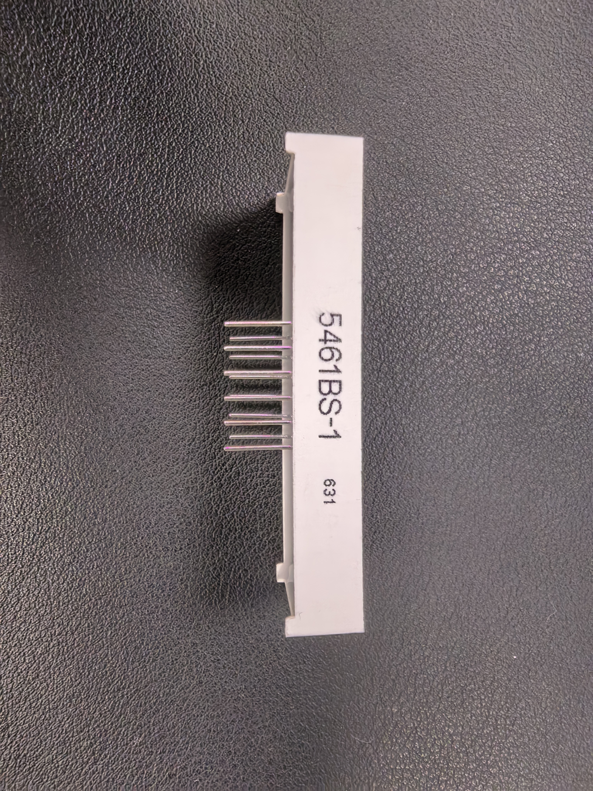

## 4.0 代码编写

### 4.1 完整代码及效果展示
下面首先给出大家完整的代码
``` 
...
static const uint8_t digit[10] = {
  0b11000000, 0b11111001, 0b10100100, 0b10110000, 0b10011001,
  0b10010010, 0b10000010, 0b11111000, 0b10000000, 0b10010000
};

void show_digital(uint8_t digital_index, uint8_t number)
{
  uint8_t segments = digit[number];

  HAL_GPIO_WritePin(A_11_GPIO_Port, A_11_Pin, (segments & (1U << 0)) ? GPIO_PIN_SET : GPIO_PIN_RESET);
  HAL_GPIO_WritePin(B_7_GPIO_Port, B_7_Pin, (segments & (1U << 1)) ? GPIO_PIN_SET : GPIO_PIN_RESET);
  HAL_GPIO_WritePin(C_4_GPIO_Port, C_4_Pin, (segments & (1U << 2)) ? GPIO_PIN_SET : GPIO_PIN_RESET);
  HAL_GPIO_WritePin(D_2_GPIO_Port, D_2_Pin, (segments & (1U << 3)) ? GPIO_PIN_SET : GPIO_PIN_RESET);
  HAL_GPIO_WritePin(E_1_GPIO_Port, E_1_Pin, (segments & (1U << 4)) ? GPIO_PIN_SET : GPIO_PIN_RESET);
  HAL_GPIO_WritePin(F_10_GPIO_Port, F_10_Pin, (segments & (1U << 5)) ? GPIO_PIN_SET : GPIO_PIN_RESET);
  HAL_GPIO_WritePin(G_5_GPIO_Port, G_5_Pin, (segments & (1U << 6)) ? GPIO_PIN_SET : GPIO_PIN_RESET);
  HAL_GPIO_WritePin(DP_3_GPIO_Port, DP_3_Pin, (segments & (1U << 7)) ? GPIO_PIN_SET : GPIO_PIN_RESET);

  switch(digital_index){
    case 1:
    HAL_GPIO_WritePin(D1_12_GPIO_Port, D1_12_Pin, GPIO_PIN_SET);
    HAL_GPIO_WritePin(D2_9_GPIO_Port, D2_9_Pin, GPIO_PIN_RESET);
    HAL_GPIO_WritePin(D3_8_GPIO_Port, D3_8_Pin, GPIO_PIN_RESET);
    HAL_GPIO_WritePin(D4_6_GPIO_Port, D4_6_Pin, GPIO_PIN_RESET);
    break;
    case 2:
    HAL_GPIO_WritePin(D2_9_GPIO_Port, D2_9_Pin, GPIO_PIN_SET);
    HAL_GPIO_WritePin(D1_12_GPIO_Port, D1_12_Pin, GPIO_PIN_RESET);
    HAL_GPIO_WritePin(D3_8_GPIO_Port, D3_8_Pin, GPIO_PIN_RESET);
    HAL_GPIO_WritePin(D4_6_GPIO_Port, D4_6_Pin, GPIO_PIN_RESET);
    break;
    case 3:
    HAL_GPIO_WritePin(D3_8_GPIO_Port, D3_8_Pin, GPIO_PIN_SET);
    HAL_GPIO_WritePin(D1_12_GPIO_Port, D1_12_Pin, GPIO_PIN_RESET);
    HAL_GPIO_WritePin(D2_9_GPIO_Port, D2_9_Pin, GPIO_PIN_RESET);
    HAL_GPIO_WritePin(D4_6_GPIO_Port, D4_6_Pin, GPIO_PIN_RESET);
    break;
    case 4:
    HAL_GPIO_WritePin(D4_6_GPIO_Port, D4_6_Pin, GPIO_PIN_SET);
    HAL_GPIO_WritePin(D1_12_GPIO_Port, D1_12_Pin, GPIO_PIN_RESET);
    HAL_GPIO_WritePin(D2_9_GPIO_Port, D2_9_Pin, GPIO_PIN_RESET);
    HAL_GPIO_WritePin(D3_8_GPIO_Port, D3_8_Pin, GPIO_PIN_RESET);
    break;
  }
}

int main(void)
{
    ...

  /* USER CODE BEGIN WHILE */

      HAL_GPIO_WritePin(A_11_GPIO_Port, A_11_Pin, GPIO_PIN_RESET);
      HAL_GPIO_WritePin(B_7_GPIO_Port, B_7_Pin, GPIO_PIN_RESET);
      HAL_GPIO_WritePin(C_4_GPIO_Port, C_4_Pin, GPIO_PIN_RESET);
      HAL_GPIO_WritePin(D_2_GPIO_Port, D_2_Pin, GPIO_PIN_RESET);
      HAL_GPIO_WritePin(E_1_GPIO_Port, E_1_Pin, GPIO_PIN_RESET);
      HAL_GPIO_WritePin(F_10_GPIO_Port, F_10_Pin, GPIO_PIN_RESET);
      HAL_GPIO_WritePin(G_5_GPIO_Port, G_5_Pin, GPIO_PIN_RESET);
      HAL_GPIO_WritePin(DP_3_GPIO_Port, DP_3_Pin, GPIO_PIN_RESET);
  uint8_t number[4];
  RTC_TimeTypeDef rtc_time = {0};
  if (HAL_RTC_GetTime(&hrtc, &rtc_time, RTC_FORMAT_BIN) != HAL_OK)
  {
    Error_Handler();
  }
  number[0] = rtc_time.Hours / 10U;
  number[1] = rtc_time.Hours % 10U;
  number[2] = rtc_time.Minutes / 10U;
  number[3] = rtc_time.Minutes % 10U;
  uint32_t last_rtc_read = HAL_GetTick();
  uint8_t digital_index = 0;
  while (1)
  {
    if (digital_index == 0U && (uint32_t)(HAL_GetTick() - last_rtc_read) >= 200U)
    {
      if (HAL_RTC_GetTime(&hrtc, &rtc_time, RTC_FORMAT_BIN) != HAL_OK)
      {
        Error_Handler();
      }
      number[0] = rtc_time.Hours / 10U;
      number[1] = rtc_time.Hours % 10U;
      number[2] = rtc_time.Minutes / 10U;
      number[3] = rtc_time.Minutes % 10U;
      last_rtc_read = HAL_GetTick();
    }
    show_digital(digital_index + 1, number[digital_index]);
    digital_index = (digital_index + 1) % 4;
    HAL_Delay(2);
    /* USER CODE END WHILE */
    
    HAL_GPIO_TogglePin(LED_R_GPIO_Port, LED_R_Pin);
    /* USER CODE BEGIN 3 */
  }
  /* USER CODE END 3 */
}
...

```

正常完成代码烧录大家能看到如下图所示的点亮效果，数码管会显示0332这几个数字

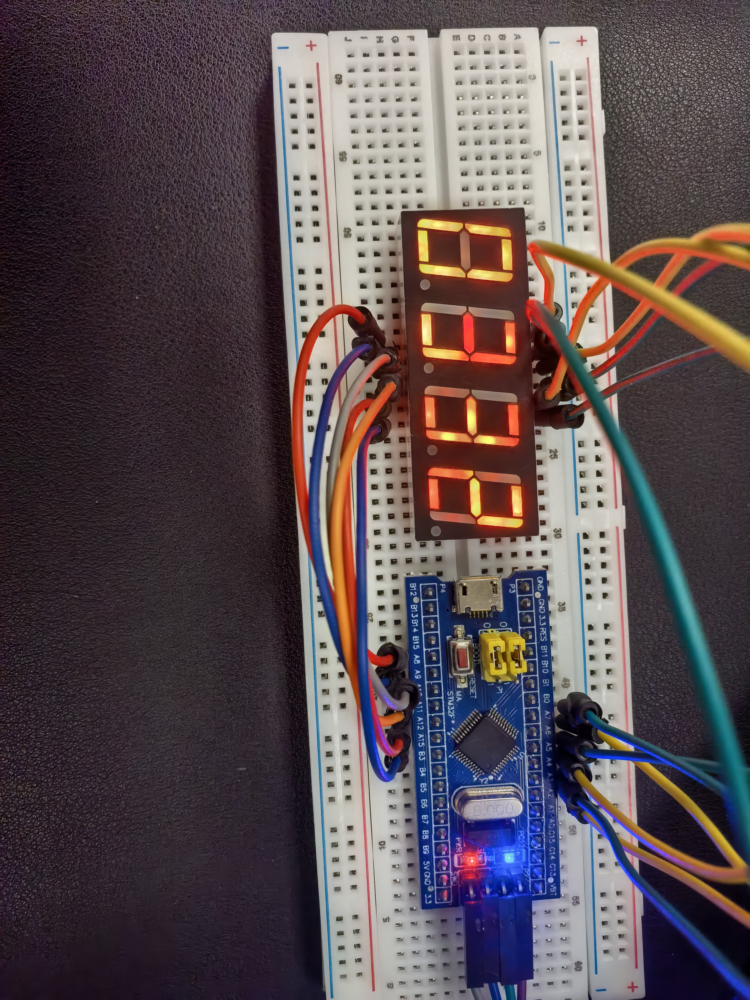

### 4.2 代码讲解
``` 
static const uint8_t digit[10] = {
  0b11000000, 0b11111001, 0b10100100, 0b10110000, 0b10011001,
  0b10010010, 0b10000010, 0b11111000, 0b10000000, 0b10010000
};
```
从前面查看数据手册我们可以知道，数码管是通过控制不同段的LED来组成相应的数字，这一段代码就是通过二进制来表示组成不同数字LED灯的亮灭

```
  uint8_t number[4];
  RTC_TimeTypeDef rtc_time = {0};
  if (HAL_RTC_GetTime(&hrtc, &rtc_time, RTC_FORMAT_BIN) != HAL_OK)
  {
    Error_Handler();
  }
  number[0] = rtc_time.Hours / 10U;
  number[1] = rtc_time.Hours % 10U;
  number[2] = rtc_time.Minutes / 10U;
  number[3] = rtc_time.Minutes % 10U;
  uint32_t last_rtc_read = HAL_GetTick();
  uint8_t digital_index = 0;
```

```
if (digital_index == 0U && (uint32_t)(HAL_GetTick() - last_rtc_read) >= 200U)
{
    if (HAL_RTC_GetTime(&hrtc, &rtc_time, RTC_FORMAT_BIN) != HAL_OK)
    {
        Error_Handler();
    }
    number[0] = rtc_time.Hours / 10U;
    number[1] = rtc_time.Hours % 10U;
    number[2] = rtc_time.Minutes / 10U;
    number[3] = rtc_time.Minutes % 10U;
    last_rtc_read = HAL_GetTick();
}    
```
这两个部分的代码主要是和前面配置的RTC相关

首先先简单介绍一下RTC；RTC的全称是Real-Time Clock（实时时钟），是单片机内部用于记录和维护日期、时间的硬件外设，其主要作用就是为整个系统提供提供可靠、持续且精确的时间基准，即使是断电或者是休眠状态下，仍然能够靠后备电源维持计时，确保时间的连续性

这两个部分主要实现了RTC时间的读取和周期性更新，程序读取到RTC的时间之后会存在存入数组，供数码管显示，之后通过计算判断达到条件后会重新读取RTC时间并更新显示数据

