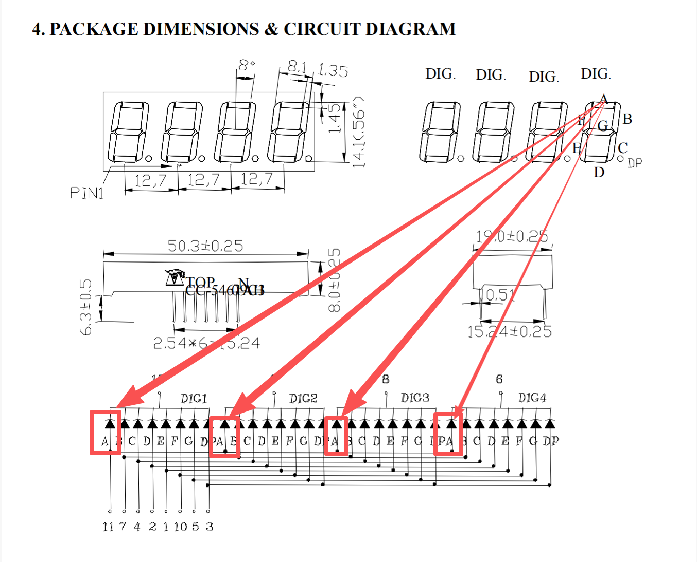
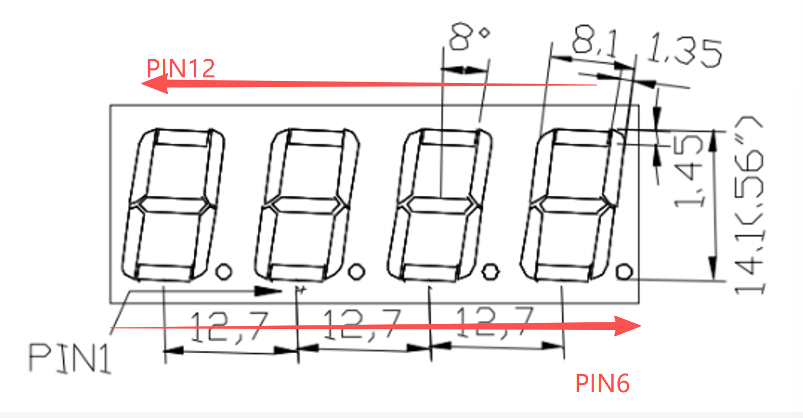
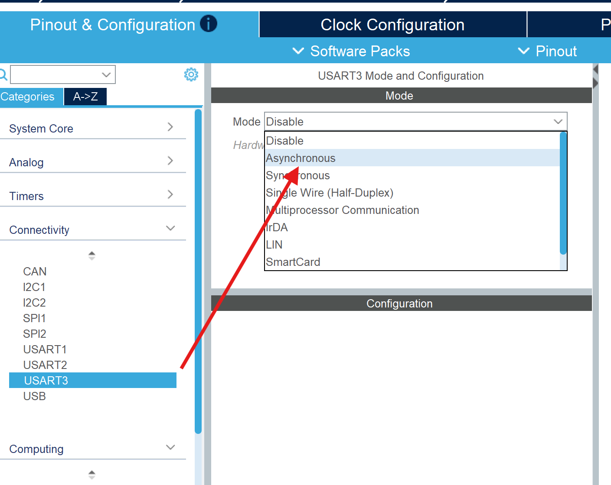
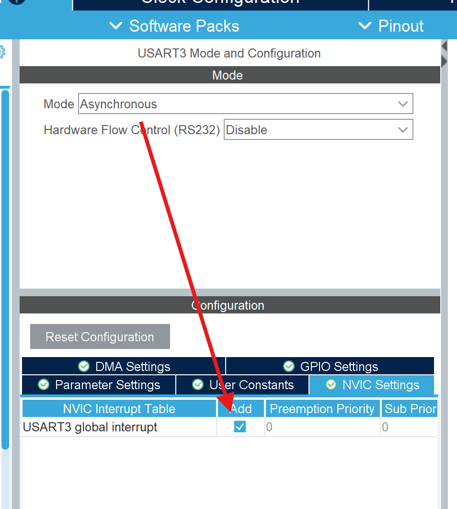
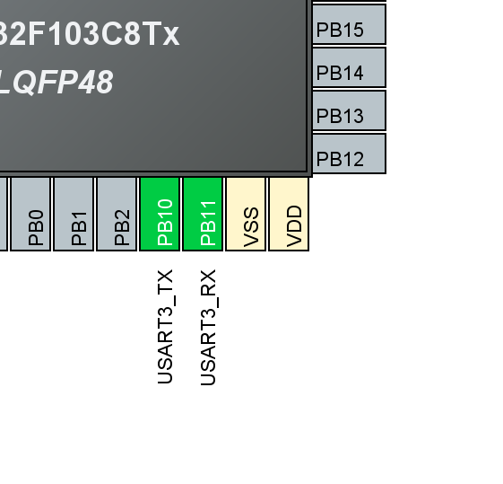

# 点亮数码管

### 1.0 数码管的原理

数码管通过轮询COM端来实现对不同数字的显示。实际上，数码管每次只显示四个数字当中的一个，依靠视觉暂留达到同时显示四个数字的效果。

数码管原理参阅：
[数码管的原理 Bilibili](https://www.bilibili.com/video/BV1Fq4y177wm/?spm_id_from=333.337.search-card.all.click&vd_source=b6333f99ef55193c60f838086ed8238c)

## 1.1 查看数据手册
在操作前，先查看手册获取相关信息[《TOP-CC-5461AH 数据手册》](TOP-CC-5461AH.pdf)
> ⚠ 注意，本手册描述的是一个共阴极数码管，但是我们套件中是共阳极数码管。关于其区别，请参阅 1.1 数码管的原理。

### 1.1.1 数码管数据手册的查看
找到第三页对数码管引脚的介绍


先看本页右上角，框出来的部分在每一节数码管上标注了该节数码管对应的字母。


将这里的字母与下面的引脚标注进行对应，例如，图中的A段数码管和下方所有A引脚是对应的。



接着查看下方引脚区域，上方四个带有DIG1/2/3/4标记的引脚是阳极，下方带有二极管A/B/C....字母段的是阴极。数码管工作时，电流从阳极流向阴极。我们将上面的四个阳极引脚称为COM端，多个阴极引脚和同一个阳极引脚相连，因此该数码管被称为共阳极数码管。


以DIG1为例，如果需点亮最上面标注为A的数码管段，在下面找到DIG1A对应的引脚，阳极为12，阴极为11，那么将11置高电平，12置低电平，这样即可点亮对应数码管段。


（图为电流方向）

## 2.0 进行芯片配置

### 2.1 GPIO配置

配置时，为了方便后续插线和配置，将阳极四个引脚作为一组，阴极八个引脚作为一组，分别配置到GPIO的相邻区域。如果想让二极管亮起，对应共阳极引脚就需要输出高电平，因此需要配置该引脚为推挽输出（可以思考一下为什么不能用开漏输出）。此外，阴极引脚必须能够输出低电平，因此开漏输出或者推挽输出均可。

> 注意如果将阴极引脚配置为开漏输出，则当GPIO置1时，引脚上电平才会被拉低。此时不能直接复用示例代码。需要反转阴极逻辑。


右键配置好的引脚，选择Enter User Label，然后对其进行命名，例如这里给PA2命名为D1_12，代表这个引脚是控制共阳极Digital1的数码管上12号引脚。这里的命名将会出现在后续的代码中，方便代码中的引脚使用。


所有引脚的配置流程都相同，配置完的整体效果可以参考下图


命名的时候不一定需要和图片保持一致，可以按照自己的接线方式进行配置。

剩下的就是GENERATE CODE，注意起手式开启Debug，然后就可以进行下一步操作了

## 3.0 接线



引脚顺序为从PIN1标记开始，向右递增，然后绕圈从上方从左向右递增。大部分电子元件的引脚，都遵循这样的绕圈编号布局。


下图为点亮数码管的参考实物接线图


## 4.0 代码编写

### 4.1 完整代码及效果展示

```c
...
static const uint8_t digit[10] = {
  0b11000000, 0b11111001, 0b10100100, 0b10110000, 0b10011001,
  0b10010010, 0b10000010, 0b11111000, 0b10000000, 0b10010000
};

void show_digital(uint8_t digital_index, uint8_t number)
{
  uint8_t segments = digit[number];

  HAL_GPIO_WritePin(A_11_GPIO_Port, A_11_Pin, (segments & (1U << 0)) ? GPIO_PIN_SET : GPIO_PIN_RESET);
  HAL_GPIO_WritePin(B_7_GPIO_Port, B_7_Pin, (segments & (1U << 1)) ? GPIO_PIN_SET : GPIO_PIN_RESET);
  HAL_GPIO_WritePin(C_4_GPIO_Port, C_4_Pin, (segments & (1U << 2)) ? GPIO_PIN_SET : GPIO_PIN_RESET);
  HAL_GPIO_WritePin(D_2_GPIO_Port, D_2_Pin, (segments & (1U << 3)) ? GPIO_PIN_SET : GPIO_PIN_RESET);
  HAL_GPIO_WritePin(E_1_GPIO_Port, E_1_Pin, (segments & (1U << 4)) ? GPIO_PIN_SET : GPIO_PIN_RESET);
  HAL_GPIO_WritePin(F_10_GPIO_Port, F_10_Pin, (segments & (1U << 5)) ? GPIO_PIN_SET : GPIO_PIN_RESET);
  HAL_GPIO_WritePin(G_5_GPIO_Port, G_5_Pin, (segments & (1U << 6)) ? GPIO_PIN_SET : GPIO_PIN_RESET);
  HAL_GPIO_WritePin(DP_3_GPIO_Port, DP_3_Pin, (segments & (1U << 7)) ? GPIO_PIN_SET : GPIO_PIN_RESET);

  switch(digital_index){
    case 1:
    HAL_GPIO_WritePin(D1_12_GPIO_Port, D1_12_Pin, GPIO_PIN_SET);
    HAL_GPIO_WritePin(D2_9_GPIO_Port, D2_9_Pin, GPIO_PIN_RESET);
    HAL_GPIO_WritePin(D3_8_GPIO_Port, D3_8_Pin, GPIO_PIN_RESET);
    HAL_GPIO_WritePin(D4_6_GPIO_Port, D4_6_Pin, GPIO_PIN_RESET);
    break;
    case 2:
    HAL_GPIO_WritePin(D2_9_GPIO_Port, D2_9_Pin, GPIO_PIN_SET);
    HAL_GPIO_WritePin(D1_12_GPIO_Port, D1_12_Pin, GPIO_PIN_RESET);
    HAL_GPIO_WritePin(D3_8_GPIO_Port, D3_8_Pin, GPIO_PIN_RESET);
    HAL_GPIO_WritePin(D4_6_GPIO_Port, D4_6_Pin, GPIO_PIN_RESET);
    break;
    case 3:
    HAL_GPIO_WritePin(D3_8_GPIO_Port, D3_8_Pin, GPIO_PIN_SET);
    HAL_GPIO_WritePin(D1_12_GPIO_Port, D1_12_Pin, GPIO_PIN_RESET);
    HAL_GPIO_WritePin(D2_9_GPIO_Port, D2_9_Pin, GPIO_PIN_RESET);
    HAL_GPIO_WritePin(D4_6_GPIO_Port, D4_6_Pin, GPIO_PIN_RESET);
    break;
    case 4:
    HAL_GPIO_WritePin(D4_6_GPIO_Port, D4_6_Pin, GPIO_PIN_SET);
    HAL_GPIO_WritePin(D1_12_GPIO_Port, D1_12_Pin, GPIO_PIN_RESET);
    HAL_GPIO_WritePin(D2_9_GPIO_Port, D2_9_Pin, GPIO_PIN_RESET);
    HAL_GPIO_WritePin(D3_8_GPIO_Port, D3_8_Pin, GPIO_PIN_RESET);
    break;
  }
}

int main(void)
{
    ...
}
...
```

>注意上方代码需要与main函数同级，定义在文件作用域中。**不推荐** 在函数中定义函数。


### 4.2 代码讲解
```c
static const uint8_t digit[10] = {
  0b11000000, 0b11111001, 0b10100100, 0b10110000, 0b10011001,
  0b10010010, 0b10000010, 0b11111000, 0b10000000, 0b10010000
};
```
从前面查看数据手册我们可以知道，数码管是通过控制不同段的LED来组成相应的数字，这一段代码就是通过二进制来表示组成不同数字LED灯的亮灭。例如，0b11000000中，从低位（右侧）到高位（左侧），最右侧的0代表A段亮起，右数第二个0代表B段亮起，只有代表G段和DP（小数点）段的两位置1，代表熄灭。根据手册可知，这个二进制码将显示为数字0。
```c
/**
 * @brief 在指定的数码管上显示一位数字
 * @param digital_index 数码管序号，取值 1~4，分别对应 DIG1~DIG4
 * @param number 要显示的数字，取值 0~9
 * @retval 无
 */
void show_digital(uint8_t digital_index, uint8_t number)
{
  // segments 的 bit0~bit7 依次对应 A~G、DP 段；共阳极数码管的段选引脚为低电平点亮，
  // 因此位为 1 时输出高电平熄灭，位为 0 时输出低电平点亮
  uint8_t segments = digit[number];
//这里的U是unsigned，意为无符号整数。
  HAL_GPIO_WritePin(A_11_GPIO_Port, A_11_Pin, (segments & (1U << 0)) ? GPIO_PIN_SET : GPIO_PIN_RESET);
  HAL_GPIO_WritePin(B_7_GPIO_Port, B_7_Pin, (segments & (1U << 1)) ? GPIO_PIN_SET : GPIO_PIN_RESET);
  HAL_GPIO_WritePin(C_4_GPIO_Port, C_4_Pin, (segments & (1U << 2)) ? GPIO_PIN_SET : GPIO_PIN_RESET);
  HAL_GPIO_WritePin(D_2_GPIO_Port, D_2_Pin, (segments & (1U << 3)) ? GPIO_PIN_SET : GPIO_PIN_RESET);
  HAL_GPIO_WritePin(E_1_GPIO_Port, E_1_Pin, (segments & (1U << 4)) ? GPIO_PIN_SET : GPIO_PIN_RESET);
  HAL_GPIO_WritePin(F_10_GPIO_Port, F_10_Pin, (segments & (1U << 5)) ? GPIO_PIN_SET : GPIO_PIN_RESET);
  HAL_GPIO_WritePin(G_5_GPIO_Port, G_5_Pin, (segments & (1U << 6)) ? GPIO_PIN_SET : GPIO_PIN_RESET);
  HAL_GPIO_WritePin(DP_3_GPIO_Port, DP_3_Pin, (segments & (1U << 7)) ? GPIO_PIN_SET : GPIO_PIN_RESET);

  // 四位数码管共用这 8 根段选线，同一时刻只能点亮其中一位：把该位的 COM 端置高电平即选中该位，
  // 其余三位拉低熄灭。轮流选通四位并借助视觉暂留，看起来就是四位数码管同时显示
  switch(digital_index){
    case 1:
    HAL_GPIO_WritePin(D1_12_GPIO_Port, D1_12_Pin, GPIO_PIN_SET);
    HAL_GPIO_WritePin(D2_9_GPIO_Port, D2_9_Pin, GPIO_PIN_RESET);
    HAL_GPIO_WritePin(D3_8_GPIO_Port, D3_8_Pin, GPIO_PIN_RESET);
    HAL_GPIO_WritePin(D4_6_GPIO_Port, D4_6_Pin, GPIO_PIN_RESET);
    break;
    case 2:
    HAL_GPIO_WritePin(D2_9_GPIO_Port, D2_9_Pin, GPIO_PIN_SET);
    HAL_GPIO_WritePin(D1_12_GPIO_Port, D1_12_Pin, GPIO_PIN_RESET);
    HAL_GPIO_WritePin(D3_8_GPIO_Port, D3_8_Pin, GPIO_PIN_RESET);
    HAL_GPIO_WritePin(D4_6_GPIO_Port, D4_6_Pin, GPIO_PIN_RESET);
    break;
    case 3:
    HAL_GPIO_WritePin(D3_8_GPIO_Port, D3_8_Pin, GPIO_PIN_SET);
    HAL_GPIO_WritePin(D1_12_GPIO_Port, D1_12_Pin, GPIO_PIN_RESET);
    HAL_GPIO_WritePin(D2_9_GPIO_Port, D2_9_Pin, GPIO_PIN_RESET);
    HAL_GPIO_WritePin(D4_6_GPIO_Port, D4_6_Pin, GPIO_PIN_RESET);
    break;
    case 4:
    HAL_GPIO_WritePin(D4_6_GPIO_Port, D4_6_Pin, GPIO_PIN_SET);
    HAL_GPIO_WritePin(D1_12_GPIO_Port, D1_12_Pin, GPIO_PIN_RESET);
    HAL_GPIO_WritePin(D2_9_GPIO_Port, D2_9_Pin, GPIO_PIN_RESET);
    HAL_GPIO_WritePin(D3_8_GPIO_Port, D3_8_Pin, GPIO_PIN_RESET);
    break;
  }
}
```
然后在主循环执行：
```c
show_digital(1,8);
```
如果数码管的第一位数字显示了8，恭喜你完成了数码管的点亮！

## 5.0 累加计时器

前面几章里，数码管显示的内容要么是写死的，要么是一次性的。这一章我们让它自己动起来：像秒表一样自动从 0 数到 9999，数满之后回到 0 重新开始。

最容易想到的写法是用 `HAL_Delay(1000)` 数秒：

```c
while (1)
{
  HAL_Delay(1000);        /* 等 1 秒 */
  seconds++;              /* 秒数加 1 */
}
```

但它有两个问题：一是 `HAL_Delay()` 会**死等**，CPU 在这一秒里什么都做不了，连数码管的动态扫描都会停下来；二是它把时间**用完就扔**，我们根本拿不到流逝的时间本身。

要解决这个问题，得先看看 `HAL_Delay()` 究竟是怎么实现的。

### 5.1 先读懂 HAL_Delay()

在 IDE 里按住 `Ctrl` 点击 `HAL_Delay`（或者右键 → 转到定义），就会跳到 `Drivers/STM32F1xx_HAL_Driver/Src/stm32f1xx_hal.c`：

```c
__weak void HAL_Delay(uint32_t Delay)
{
  uint32_t tickstart = HAL_GetTick();   /* 记下开始时刻 */
  uint32_t wait = Delay;

  /* 加上一个最小单位，保证至少等待 Delay 毫秒 */
  if (wait < HAL_MAX_DELAY)
  {
    wait += (uint32_t)(uwTickFreq);
  }

  while ((HAL_GetTick() - tickstart) < wait)   /* 死等，直到时间凑够 */
  {
  }
}
```

（不同版本的 HAL 库这一小段写法会略有差别，以你工程里看到的为准。）

这里面有两个关键角色：

**一是 `HAL_GetTick()`。** 它返回一个叫 `uwTick` 的全局变量：

```c
__weak uint32_t HAL_GetTick(void)
{
  return uwTick;
}
```

而 `uwTick` 是被 **SysTick 中断 课上讲的系统滴答中断**每 1 毫秒加 1 的，在 `stm32f1xx_it.c` 里：

```c
void SysTick_Handler(void)
{
  HAL_IncTick();          /* 内部就是 uwTick += 1 */
}
```

所以 `uwTick` 的含义是"开机到现在过了多少毫秒"，它是**独立于主循环**在后台走的。

**二是 `HAL_GetTick() - tickstart` 这个减法。** 两次取值相减，得到的就是中间流逝的毫秒数。这里用的是无符号减法，即使 `uwTick` 一直加到溢出回绕，差值依然是对的——这是嵌入式里判断"过了多久"最常用的写法。

`HAL_Delay()` 的做法是：算出差值之后，用 `while` 在原地**死等**到时间凑够。换句话说：

> **它其实已经在算时间了，只是算完之后把时间扔掉，只拿它来拖住 CPU。**

我们要做的，就是把它最后这一步改掉。

### 5.2 复制出来，改造成累加计时器

把 `HAL_Delay()` 的骨架复制出来（不用去改 HAL 库本身），改成不等待、只**累加**：

```c
uint32_t        timer_accum = 0;        /* 已累计的毫秒数 */
static uint32_t timer_last_tick = 0;    /* 上一次取时刻的基准 */

void Timer_Update(void)
{
  uint32_t now = HAL_GetTick();         /* 对应原版里的 HAL_GetTick() */

  /* 原版在这里 while 死等，我们改成把流逝的时间累加起来 */
  timer_accum += (uint32_t)(now - timer_last_tick);

  timer_last_tick = now;                /* 基准跟上，下次算的才是新的一段 */
}
```

和原版对比一下：

| `HAL_Delay()` | `Timer_Update()` |
|---|---|
| `while ((HAL_GetTick() - tickstart) < wait) {}` | `timer_accum += (now - timer_last_tick)` |
| 死等到时间凑够才返回 | 立刻返回，不阻塞 |
| 流逝的时间用完就扔 | 流逝的时间被保存下来 |

### 5.3 把累计的毫秒换算成要显示的数字

数码管只有 4 位，我们把累计的毫秒换算成秒，再拆成 4 个数字：

```c
uint8_t display_number[4] = {0, 0, 0, 0};   /* 数码管四位要显示的数字 */

void Timer_Refresh_Display(void)
{
  /* 毫秒换算成秒；% 10000 让它数满 9999 之后自动回到 0 重新开始 */
  uint32_t seconds = (timer_accum / 1000U) % 10000U;

  display_number[0] = (uint8_t)(seconds / 1000U);
  display_number[1] = (uint8_t)(seconds / 100U % 10U);
  display_number[2] = (uint8_t)(seconds / 10U % 10U);
  display_number[3] = (uint8_t)(seconds % 10U);
}
```

### 5.4 主循环

```c
uint8_t digital_index = 0;

while (1)
{
  Timer_Update();                 /* 累加计时，不阻塞 */
  Timer_Refresh_Display();        /* 把累计的时间换算成 4 个数字 */

  show_digital(digital_index + 1, display_number[digital_index]);   /* 扫描一位 */
  digital_index = (digital_index + 1) % 4;
  HAL_Delay(2);
}
```

烧录后，数码管会从 `0000` 开始每秒加 1，数到 `9999` 之后回到 `0000` 继续——一个自动循环的秒表。

**这里值得记住的一点**：主循环里的 `HAL_Delay(2)` 依然是阻塞的，但这并不影响计时的准确性。因为 `Timer_Update()` 每次只是"读一下时钟、把差值累加进去"，时间是由后台的 SysTick 保证的，而不是靠主循环转得够快。这就是**非阻塞计时器**的好处——也正是我们改造 `HAL_Delay()` 的意义所在。


## 6.0 通过 UART 通信

上一章的计时器跑起来了，但它只能自己闷头跑：我们既没法让它暂停或清零，也没法从外面给它送数据。

这一章来解决"通信"的问题：让单片机通过**串口（UART）**和电脑交换数据。先实现最直接的用法——电脑发什么数字，数码管就显示什么；然后再用串口指令去控制上一章的计时器。

### 6.1 配置 USART3

回到 CubeMX，在左侧 `Connectivity` → `USART3` 里配置：

- `Mode` 选择 `Asynchronous`（异步串口，也就是异步收发串口）
- `Parameter Settings` 里设置：
  - `Baud Rate` 填 `115200`（波特率，必须和上位机一致，否则收到的全是乱码）
  - `Word Length`，即帧头和帧尾之间的字长 选 `8 Bits`。8bits也是大部分计算机系统的默认字长。
  - `Parity` 选 `None`
  - `Stop Bits` 选 `1`
- 切到 `NVIC Settings`，勾选 `USART3 global interrupt`（我们用中断方式收数据）




配置完可以看到引脚图上 `PB10` 自动变成 `USART3_TX`，`PB11` 自动变成 `USART3_RX`。



> **为什么不用 USART1？** 12 个数码管引脚已经占用了 PA2~PA12 和 PA15（PA13/PA14 要留给 SWD 烧录调试），所以 USART1（PA9/PA10）和 USART2（PA2/PA3）的引脚都被占掉了，F103C8T6 上能用的只剩 USART3（PB10/PB11）。

### 6.2 接线

用 USB 转 TTL 模块把电脑和开发板连起来。注意要**交叉连接**（发对收、收对发），而且**必须共地**：

| USB 转 TTL | 开发板 | 说明 |
|---|---|---|
| RXD | PB10 | 接收开发板发出来的数据（USART3_TX） |
| TXD | PB11 | 给开发板发数据（USART3_RX） |
| GND | GND | 共地，不然电平没有参考，收到的会是乱码 |

<!-- 截图：USB 转 TTL 与开发板的接线实物图 -->

### 6.3 用中断接收数据

串口的数据是**一个字节一个字节**到来的。如果让 CPU 一直守在串口那里等（轮询），那别的事就都干不了了——数码管的动态扫描也会跟着卡住。所以我们用**中断**：每收到一个字节，硬件通知 CPU，HAL 库自动调用我们写好的**回调函数**，我们在回调里处理这个字节。

只需要再加一个变量，用来放"本次收到的这一个字节"：

```c
uint8_t uart_rx_byte = 0;   /* 本次收到的 1 个字节 */
```

还有一件事：上一章的 `display_number` 现在要被**中断**改写了，所以要在它前面补上 `volatile`：

```c
volatile uint8_t display_number[4] = {0, 0, 0, 0};
```

`volatile` 的意思是"这个变量的值可能被程序之外的东西（这里是中断）改动"。加上它，编译器就不会把它优化进寄存器，每次都会老老实实重新从内存读——否则主循环可能一直读不到中断里更新过的值。

在 `main()` 里，进入 `while (1)` **之前**先启动一次接收：

```c
/* 启动接收：收满 1 个字节后 HAL 会自动调用 HAL_UART_RxCpltCallback */
HAL_UART_Receive_IT(&huart3, &uart_rx_byte, 1);
```

然后再实现回调函数（写在 `main.c` 的 `/* USER CODE */` 区间里）：

```c
void HAL_UART_RxCpltCallback(UART_HandleTypeDef *huart)
{
  if (huart->Instance == USART3)
  {
    if (uart_rx_byte >= '0' && uart_rx_byte <= '9')
    {
      /* 收到的是数字字符：整体左移一位，新数字从最右边进来 */
      display_number[0] = display_number[1];
      display_number[1] = display_number[2];
      display_number[2] = display_number[3];
      display_number[3] = (uint8_t)(uart_rx_byte - '0');
    }

    /* 关键：重新启动接收，否则只能收到第一个字节 */
    HAL_UART_Receive_IT(&huart3, &uart_rx_byte, 1);
  }
}
```

这里有两个非常容易踩的坑：

1. **`HAL_UART_Receive_IT()` 是一次性的。** 它收满指定长度后就自动关闭接收了，所以必须在回调里**重新调用一次**，不然你只能收到第一个字节。
2. **回调是在中断里执行的，要尽量短。** 所以这里只做搬运和赋值，不要在里面放 `HAL_Delay()` 这类耗时的操作，否则会拖慢整个中断系统。

### 6.4 让数码管显示出来

回调只是把数字存进了 `display_number`，真正显示还是靠主循环的动态扫描。这一节先只显示串口收到的内容，所以把上一章的 `Timer_Update()` 和 `Timer_Refresh_Display()` 从主循环里暂时去掉：

```c
uint8_t digital_index = 0;

HAL_UART_Receive_IT(&huart3, &uart_rx_byte, 1);   /* 启动串口接收 */

while (1)
{
  show_digital(digital_index + 1, display_number[digital_index]);
  digital_index = (digital_index + 1) % 4;
  HAL_Delay(2);
}
```

烧录后在串口助手里发送 `1234`，数码管上就会从左到右显示出 `1234`——每发一位数字，原来的数字整体左移一位，新数字从最右边补进来。

### 6.5 用串口指令控制计时器

光显示还不够——我们真正想要的是**用串口控制上一章的计时器**。约定三条单字符指令：

| 发送 | 作用 |
|---|---|
| `s` | 开始 / 继续计时 |
| `p` | 暂停 |
| `r` | 清零 |

先给计时器加上"正在计时"和"清零请求"两个标志，并让 `Timer_Update()` 只在计时中累加：

```c
volatile uint8_t timer_running = 0;     /* 1 = 正在计时，0 = 暂停，会在串口中断里改写 */
volatile uint8_t timer_reset_req = 0;   /* 清零请求，由串口中断置位 */

void Timer_Update(void)
{
  uint32_t now = HAL_GetTick();

  if (timer_running)                    /* 只有计时中才累加 */
  {
    timer_accum += (uint32_t)(now - timer_last_tick);
  }

  timer_last_tick = now;                /* 基准照样跟上，暂停期间的时间不会被算进去 */
}
```

再把 6.3 的回调从"只认数字"改成"数字 + 指令"一起处理：

```c
void HAL_UART_RxCpltCallback(UART_HandleTypeDef *huart)
{
  if (huart->Instance == USART3)
  {
    switch (uart_rx_byte)
    {
      case '0': case '1': case '2': case '3': case '4':
      case '5': case '6': case '7': case '8': case '9':
        /* 数字：左移进显示缓冲区 */
        display_number[0] = display_number[1];
        display_number[1] = display_number[2];
        display_number[2] = display_number[3];
        display_number[3] = (uint8_t)(uart_rx_byte - '0');
        break;

      case 's':                       /* 开始计时 */
        timer_running = 1;
        break;

      case 'p':                       /* 暂停计时 */
        timer_running = 0;
        break;

      case 'r':                       /* 清零：只置请求，真正的清零交给主循环做 */
        timer_reset_req = 1;
        break;

      default:                        /* 其他字符忽略 */
        break;
    }

    HAL_UART_Receive_IT(&huart3, &uart_rx_byte, 1);   /* 别忘了重新启动接收 */
  }
}
```

注意清零这里**只在中断里置一个标志**，真正的清零和刷新留给主循环做。这仍然是为了让中断尽量短——而且 `timer_accum` 只在主循环里被改写，也就不用担心"中断改到一半被主循环写回去"这类问题。

最后把主循环恢复成"计时 + 显示"，并处理清零请求：

```c
uint8_t digital_index = 0;

HAL_UART_Receive_IT(&huart3, &uart_rx_byte, 1);   /* 启动串口接收 */

while (1)
{
  if (timer_reset_req)              /* 处理串口发来的清零请求 */
  {
    timer_accum = 0;
    timer_last_tick = HAL_GetTick();   /* 基准一起重置，避免把清零前的时间算进来 */
    timer_reset_req = 0;
    Timer_Refresh_Display();        /* 立刻把数码管刷成 0000 */
  }
  else
  {
    Timer_Update();                 /* 累加计时，不阻塞 */
  }

  if (timer_running)
  {
    Timer_Refresh_Display();        /* 计时中持续刷新显示 */
  }

  show_digital(digital_index + 1, display_number[digital_index]);   /* 扫描一位 */
  digital_index = (digital_index + 1) % 4;
  HAL_Delay(2);
}
```

烧录后：

- 发送 `s`，数码管从 `0000` 开始每秒加 1；
- 发送 `p`，数字停住；
- 发送 `r`，回到 `0000`；
- 计时器没在跑的时候，仍然可以用串口发数字（比如 `1234`）让数码管显示 6.4 的效果；**计时中显示会被计时值接管**。
